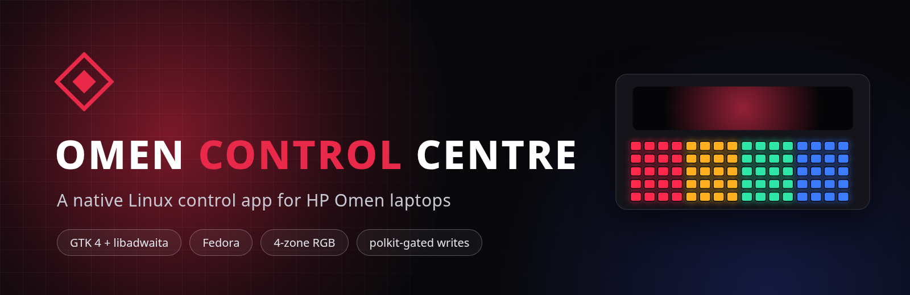
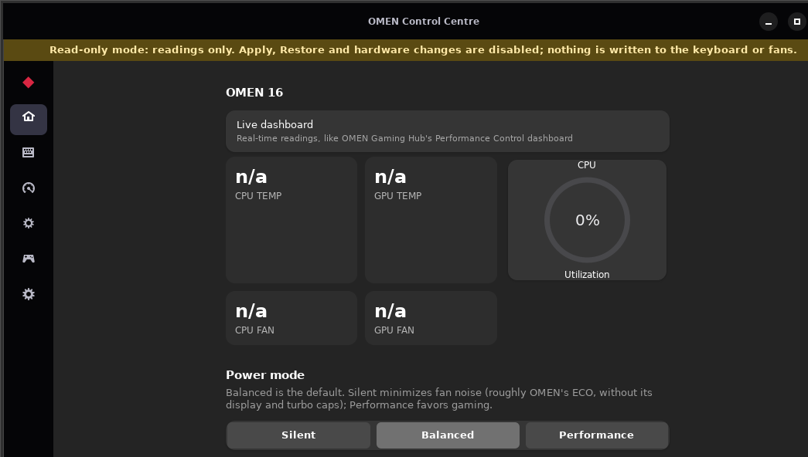
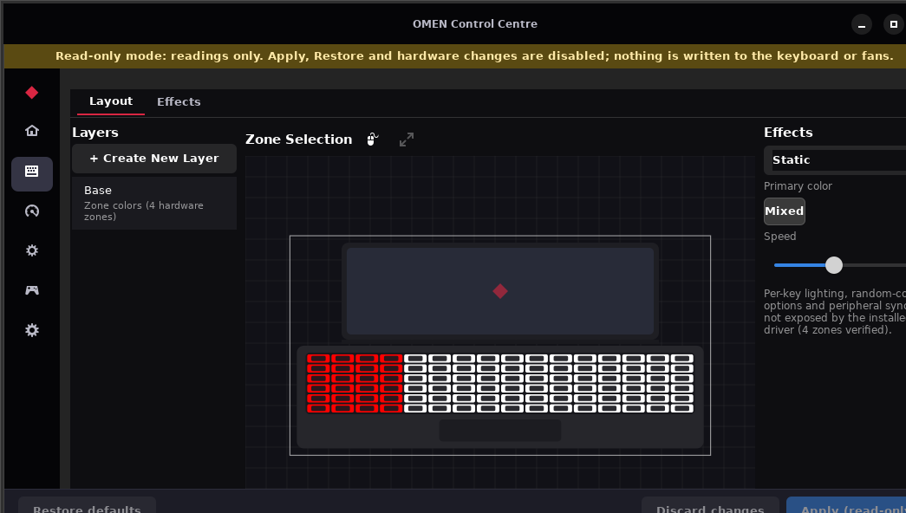
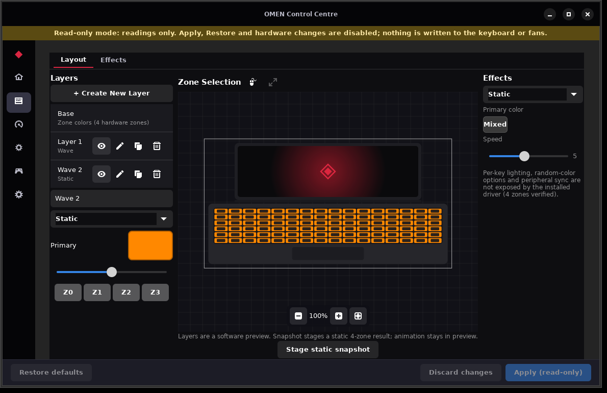
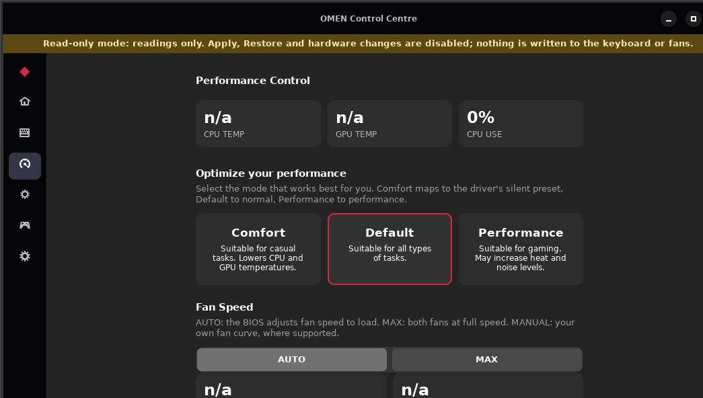
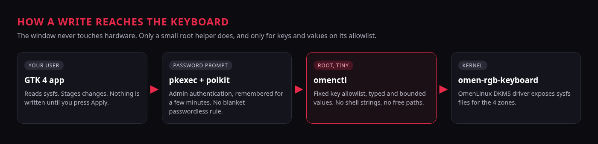

<p align="center">
  
</p>

<p align="center">
  
  
  
  
  
</p>

<p align="center">
  <b>Lighting, fans and vitals for HP Omen laptops on Linux, in one native window.</b><br>
  Built on the <a href="https://github.com/OmenLinux/omen-rgb-keyboard">OmenLinux omen-rgb-keyboard</a> kernel driver.
</p>

<p align="center">
  <a href="#quick-start">Quick start</a> &middot;
  <a href="#what-you-get">Features</a> &middot;
  <a href="#how-writes-stay-safe">Safety</a> &middot;
  <a href="#verification-status">Verification status</a> &middot;
  <a href="#zone-order">Zone order</a>
</p>

---

## See it

<table>
  <tr>
    <td width="50%"><br><sub><b>Home.</b> Live vitals and power mode.</sub></td>
    <td width="50%"><br><sub><b>Lighting.</b> Four zones, staged Apply, preview canvas.</sub></td>
  </tr>
  <tr>
    <td width="50%"><br><sub><b>Layers.</b> Duplicate, rename, hide. Preview only by design.</sub></td>
    <td width="50%"><br><sub><b>Performance.</b> Modes and fan control (off in lighting-only installs).</sub></td>
  </tr>
</table>

<sub>Screenshots are rendered from the app against a mock sysfs tree in read-only mode, so sensor readings show <code>n/a</code>.</sub>

## What you get

| | |
|---|---|
| **Lighting** | Per-zone colours, all-zone colour, brightness, 12 driver animations, gradient config, brightness lock |
| **Light Studio style editor** | Layout and Effects tabs, zoomable preview, stackable software layers |
| **Performance** | Thermal profiles, fan AUTO / MAX, CPU and GPU fan RPM, power limits shown read-only |
| **Vitals** | CPU and GPU temperature, load, memory, storage, network, top processes |
| **My Games** | Finds Steam libraries and launches installed games |
| **Safe by default** | Unprivileged window, allowlisted root helper, read-only launch mode, lighting-only install |

## Quick start

```bash
git clone https://github.com/mananbharti/omen-centre.git
cd omen-centre

# look around without changing anything
OMEN_READ_ONLY=1 python3 src/omen-centre.py      # or ./run-readonly.sh

# install (lighting only: fan and performance writes are refused)
sudo sh install.sh --lighting-only

# full install
sudo sh install.sh
```

You need the `omen-rgb-keyboard` DKMS module loaded (`lsmod | grep omen_rgb_keyboard`), plus python3, gtk4, libadwaita and pkexec (all on a stock Fedora Workstation).

Before your first real hardware write, read [docs/FIRST-WRITE-TEST.md](docs/FIRST-WRITE-TEST.md). It has a backup step and a way back.

## How writes stay safe

<p align="center"></p>

- Changes are staged. Nothing reaches the keyboard until you press **Apply**.
- Read-only mode refuses every write before anything is sent to pkexec.
- The driver rewrites all four zones from its own state on any zone write, so the app never claims one Apply touches only one zone.
- Software layers are preview only. They are not streamed to the keyboard.

## Verification status

What has and has not been proven. Nothing here is called "pixel perfect": the layout follows OMEN Gaming Hub screenshots, not its binary.

| Area | Status |
| --- | --- |
| Unit tests (helper allowlist, validators, install, colour parsing, zone order, layers) | Pass, against a mock sysfs tree |
| GUI rendering | Checked in a virtual display (screenshots above); also seen running on Fedora 44 / GNOME 50 |
| Privileged write path (`pkexec` + polkit + `omenctl`) | Staged and mocked only. Not yet proven end to end on real hardware |
| Keyboard colour writes on real hardware | Not confirmed by this project yet |
| Fan, thermal and power-limit writes | Not tested. Disabled by `--lighting-only` |
| Zone left-to-right order | Differs by keyboard. One user reports Z0 on the physical right. Use Identify, or set `OMEN_ZONE_ORDER` |
| Animations, gradient, brightness lock, sleep/resume, reboot persistence | Not tested on hardware |

## Zone order

The four zones are numbered by the driver (`zone00` to `zone03`). Where each one sits on the keyboard can differ from the on-screen left-to-right order. **Identify zones** lights the four zones red, green, blue and white after a confirmation, saves your previous colours first, asks which colour you see at each position, stores the order, and tries to restore your colours. If the restore does not finish, the app offers to finish it on next start. You can also set the order by hand, for example `OMEN_ZONE_ORDER=3,2,1,0` (screen slot 1 to 4 mapped to hardware zones).

---

<details>
<summary><b>Design reference</b></summary>

The layout mirrors Windows OMEN Gaming Hub (OGH), studied from HP's
official documentation (support.hp.com doc ish_3912817-3737596-16), the
70 official OGH UI screenshots HP hosts on kaas.hpcloud.hp.com for that
doc, and the current Microsoft Store listing screenshots for OGH
(Store product 9NQDW009T0T5, official displaycatalog API): left
navigation rail, Home dashboard with live vitals, Performance Control
(Comfort/Default/Performance mode cards + Fan Speed AUTO/MAX/MANUAL),
Lighting with a staged Restore/Discard/Apply workflow and basic color
swatches, System Vitals with Top Processes, My Games, Key assignments.
This is a screenshot/document-guided re-implementation for the Linux
driver - the Windows binary itself has not been inspected. The app's
Comfort maps to the driver's silent preset, Default to normal,
Performance to performance (roughly OMEN's ECO/Balanced/Performance,
without HP's display/turbo caps).

</details>

<details>
<summary><b>Full feature list</b></summary>

**Lighting**
- Per-zone colors (4 zones) and all-zone color
- Brightness 0-100
- 12 animations (static, breathing, rainbow, wave, pulse, chase, sparkle,
  candle, aurora, disco, gradient, spectrum) with speed 1-10
- Custom gradient configuration
- Brightness lock (stops the desktop dimming the keyboard when idle)
- "Identify zones" button: lights zones red/green/blue/white so you can see
  which key area each zone covers (mapping varies by keyboard)
- Light Studio-style editor: Layout/Effects tabs, gridded laptop canvas
  with clickable zone bands, zoom controls, and software layers

**Software layers (preview-only by design)**
- "+ Create New Layer" stacks any number of software effect layers
  (static, breathing, wave, pulse, rainbow, gradient, sparkle, candle),
  each with its own colors, speed and zone mask, composited live on the
  canvas preview
- Layers are NOT streamed to the keyboard. Per the driver source
  (OmenLinux/omen-rgb-keyboard): every zone sysfs write force-stops the
  driver software animation (restoring all 4 zones) and does a synchronous state
  save to /var/lib/omen-rgb-keyboard/state, so sustained userspace
  streaming would mean ~5x WMI traffic plus dozens of disk writes per
  second. Hardware-rate tolerance of the interface is also not validated.
  Smooth multi-layer animation therefore stays on the preview canvas.
- Layers can be created, duplicated, renamed, shown/hidden, deleted, and are
  saved across restarts. Secondary colour is offered only for Wave and
  Gradient, the effects that use it
- "Stage static snapshot" writes the current composite as a static
  4-zone color set through the normal staged Apply flow - no silent
  flattening: the UI says the animation itself stays preview-only

**Fans & performance**
- Live CPU / GPU fan RPM
- Max fan toggle
- Thermal profiles: Silent / Normal / Performance (same presets as the
  GNOME power menu via power-profiles-daemon)
- CPU power limits PL1/PL2: read-only display. The helper has no
  writable power-limits key at all: no model-safe range is published
  for this laptop, so the control stays off everywhere, not just in
  the GUI
- Custom fan curve editor (2-8 points) - shown only when the laptop's fan
  interface supports it; classic-interface models get an honest
  "not supported on this model" note instead of a dead control

**Vitals**
- CPU package temperature, GPU temperature (when the GPU driver exposes it),
  CPU load, memory, storage, network throughput, top processes by CPU

**My Games**
- Scans Steam libraries (libraryfolders.vdf + appmanifests) and lists
  installed games with a Launch button (steam://rungameid)

**Settings**
- Theme: Auto / Light / Dark (persisted; Dark is the OGH-true default)
- Omen-key binding: opens this app via a GNOME custom shortcut
  (XF86DOS), user-session, reversible

</details>

<details>
<summary><b>OMEN Gaming Hub capability matrix</b></summary>

Grounded classification (sources: HP doc above, Microsoft Store listing,
Fedora package sources). HP's proprietary implementations are
Windows-only, but most OGH *functionality* has native Linux paths:

| OGH feature | Status here |
| --- | --- |
| Lighting, fans, vitals, games, Omen key | In this app |
| Macros / key remapping | Native tool: input-remapper (Fedora repo) |
| In-game FPS overlay | Native tool: MangoHud (Fedora repo) |
| Per-game performance boost | Native tool: GameMode (Fedora repo) |
| Network Booster (per-app priority) | Possible natively (cgroup v2 + nftables/tc); not yet implemented; HP's own impl is Windows-only |
| Light Studio (custom effect canvas) | Partly: Layout/Effects editor with preview-only layers |
| OMEN AI, Shop Games, Deals, Gallery | HP cloud/storefront services - not applicable to a local control app |
| GPU MUX / display mode | Per-app GPU offload works natively (PRIME, wiki.archlinux.org/title/PRIME); whole-display switching is a BIOS option on this model class (unit specifics unverified) |
| Overclocking/undervolting | Intel HX is an unlocked SKU, but HP notebook BIOSes usually lock voltage control and OGH offers no OC on this notebook class; unverified on this unit |

</details>

<details>
<summary><b>Security model</b></summary>

- The GUI runs unprivileged and only reads sysfs.
- All writes go through `omenctl`, a small root helper that validates every
  key against a fixed allowlist and every value against typed, bounded
  validators (hex colors, integer ranges, curve grammar). No shell strings,
  no arbitrary paths.
- The helper runs via pkexec under a polkit policy that requires admin
  authentication (`auth_admin_keep`): one password prompt, remembered for a
  few minutes. No blanket passwordless grant.
- Power-limit bounds reference the CPU spec (i7-14650HX: 55 W base,
  157 W max turbo per Intel ARK); "Restore defaults" always hands control
  back to the BIOS.

</details>

<details>
<summary><b>Development and testing without an Omen laptop</b></summary>

```bash
# unit tests for the privileged helper (mock sysfs, no root)
python3 tests/test_omenctl.py

# run the GUI against a mock sysfs tree
mkdir -p /tmp/omen-mock/{rgb_zones,fan}
for f in zone00 zone01 zone02 zone03 all brightness animation_mode \
         animation_speed gradient_config brightness_lock mute_led mute_state; do
  echo -n "" > /tmp/omen-mock/rgb_zones/$f
done
for f in max_fan thermal_profile power_limits fan_curve fan_curve_enable \
         fan_temp_zone cpu_fan_rpm gpu_fan_rpm; do
  echo -n "" > /tmp/omen-mock/fan/$f
done
echo -n "3000" > /tmp/omen-mock/fan/cpu_fan_rpm
echo -n "3300" > /tmp/omen-mock/fan/gpu_fan_rpm
echo -n "normal" > /tmp/omen-mock/fan/thermal_profile
echo -n "FFFFFF" > /tmp/omen-mock/rgb_zones/all
echo -n "100" > /tmp/omen-mock/rgb_zones/brightness
echo -n "static" > /tmp/omen-mock/rgb_zones/animation_mode
echo -n "5" > /tmp/omen-mock/rgb_zones/animation_speed
echo -n "30:20 50:40 70:70 90:100" > /tmp/omen-mock/fan/fan_curve
echo -n "0" > /tmp/omen-mock/fan/fan_curve_enable
OMEN_SYSFS_ROOT=/tmp/omen-mock OMEN_DIRECT_WRITE=1 \
OMENCTL=$PWD/helper/omenctl python3 src/omen-centre.py
```

`OMEN_DIRECT_WRITE=1` is a test-only escape hatch: it runs `omenctl`
directly (unprivileged, against the mock tree) instead of through
pkexec. Never set it in production - the packaged app always goes
through pkexec with per-action admin authentication, and the privileged
write path still needs its own on-device test.

</details>

<details>
<summary><b>Effects are driver-side software animations</b></summary>

The driver's 12 animation modes are not rendered by keyboard firmware. Per
src/animations/omen_animations.c (OmenLinux/omen-rgb-keyboard), a kernel
timer queues a workqueue function that computes colors each tick and
writes them to the zones through WMI. The keyboard therefore receives
repeated color updates while the laptop is awake. Not validated on
hardware: behavior across sleep, WMI traffic cost, and visual match with
the in-app preview.

</details>

## License

GPL-3.0, matching the kernel driver. Not affiliated with or endorsed by HP. OMEN is a trademark of HP Inc.
